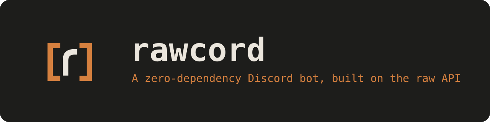

<p align="center"></p>

# rawcord

A Discord bot template with **no Discord libraries**: raw Gateway (WebSocket), raw REST (`fetch`), and Node's built-in SQLite. Clone it, add your token, run it.

## Requirements

- Node.js with native TypeScript support and `--env-file` (Node 24+ recommended)
- A bot token and application ID from the [Discord Developer Portal](https://discord.com/developers/applications)

## Setup

```bash
git clone <your-repo-url> rawcord
cd rawcord
npm install
cp .env.example .env   # then set BOT_TOKEN
npm run dev
```

`.env`:

```
BOT_TOKEN="your-bot-token"
APPLICATION_ID="your-application-id"
GUILD_ID=""   # optional: register commands to one guild (instant) instead of globally
```

## Scripts

| Command       | What it does                                         |
| ------------- | ---------------------------------------------------- |
| `npm run dev` | Runs `src/index.ts` with `--watch` and loads `.env`  |

## Project structure

```
src/
├── index.ts              # Entry point: loads events and commands, registers commands, connects
├── config.ts             # Loads and validates BOT_TOKEN, APPLICATION_ID, optional GUILD_ID
├── constants.ts          # Discord API version and base URL (v10)
├── commands/
│   ├── ping.ts           # /ping: replies "pong!"
│   └── status.ts         # /status: bot info card (Components V2)
├── core/
│   ├── typed-emitter.ts  # Typed on / once / off / emit for gateway events
│   ├── define-event.ts   # defineEvent() helper for event files
│   ├── load-events.ts    # Imports every file in src/events/ and registers it
│   ├── define-command.ts # defineCommand() helper for command files
│   ├── load-command.ts   # Imports every file in src/commands/ into the commands map
│   └── register-commands.ts # Syncs the commands map with Discord (only if changed)
├── events/
│   ├── ready.ts            # READY handler (logs the client is ready)
│   ├── interactionCreate.ts # Routes slash commands to src/commands/
│   └── messageCreate.ts    # MESSAGE_CREATE handler (empty stub)
├── gateway/
│   ├── gateway.ts        # WebSocket connection, heartbeat, identify, dispatch (op 0)
│   └── events.ts         # EVENT_NAMES: every valid gateway event name
├── rest/
│   ├── client.ts         # Minimal REST client (fetch + bot auth)
│   └── instance.ts       # Shared Rest instance
├── types/
│   └── types.ts          # Gateway payload types, GatewayEvents map, Command
└── utils/
    ├── format.ts         # formatUptime()
    ├── intents.ts        # Gateway intents
    └── log.ts            # Logger
```

## Intents

All intents are enabled by default in [src/utils/intents.ts](src/utils/intents.ts). To remove one, comment it out. `GuildMembers`, `GuildPresences` and `MessageContent` are **privileged**: enable them in the Developer Portal under *Bot → Privileged Gateway Intents*, or the gateway will close the connection.

## REST

```ts
const me = await rest.get<{ username: string }>("/users/@me");
```

`get`, `post` and `put` are implemented. `PATCH` and `DELETE` are already typed in `#request`, so add a public method per verb as you need them.

## Events

Each file in `src/events/` handles one Gateway event. Files in subfolders are picked up too. The event name comes from `defineEvent()`, so the file name doesn't matter. A file whose default export is a plain function uses its file name instead: `messageCreate.ts` (or `message-create.ts`) handles `MESSAGE_CREATE`. The name must be in `EVENT_NAMES` ([src/gateway/events.ts](src/gateway/events.ts)), or the loader logs an error and skips the file.

```ts
// src/events/messageCreate.ts
import { defineEvent } from "../core/define-event.ts";

export default defineEvent("MESSAGE_CREATE", (message) => {
  console.log(message.content);
});
```

The handler's `data` is typed from the `GatewayEvents` map in [src/types/types.ts](src/types/types.ts). To type a new event, add it to that map.

## Commands

Each file in `src/commands/` is one slash command (subfolders work too). Export a `defineCommand()` and the loader picks it up. Command names must be unique; duplicates are logged and skipped.

```ts
// src/commands/ping.ts
import { defineCommand } from "../core/define-command.ts";
import { rest } from "../rest/instance.ts";

export default defineCommand({
  name: "ping",
  description: "Replies to pong",
  execute: async (interaction) => {
    await rest.post<void>(`/interactions/${interaction.id}/${interaction.token}/callback`, {
      type: 4,
      data: { content: "pong!" },
    });
  },
});
```

On startup, `registerCommands()` compares your commands (name and description) with what Discord has and only sends a `PUT` when they differ. Set `GUILD_ID` for instant guild-scoped updates while developing; leave it empty to register globally (can take a while to propagate). Options are not supported yet.

## Status

Early template. Connects to the Gateway, heartbeats, identifies, and dispatches events (`op 0`). Slash commands (`/ping`, `/status`) are loaded, registered and routed via `INTERACTION_CREATE`. `MESSAGE_CREATE` is an empty stub. SQLite is not wired up yet. The `/status` card currently shows placeholder values.

## License

ISC © SimbaCodes
